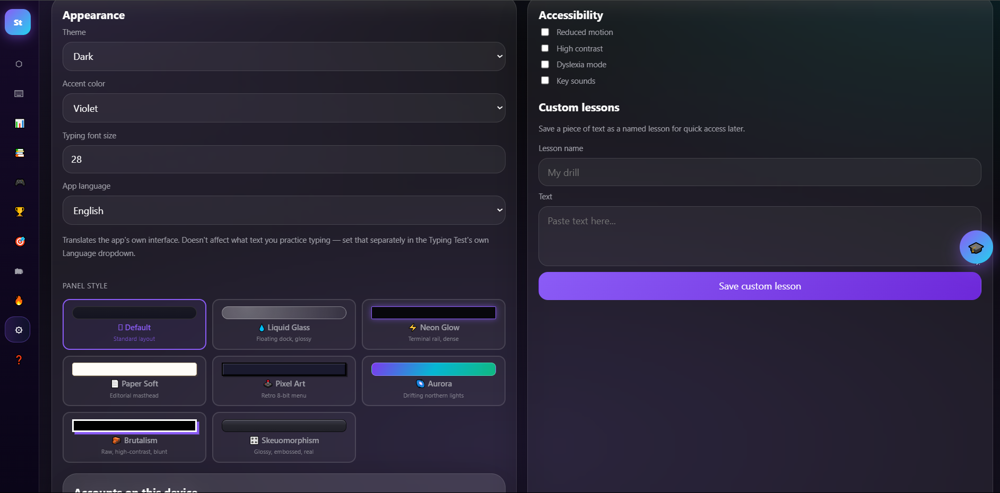
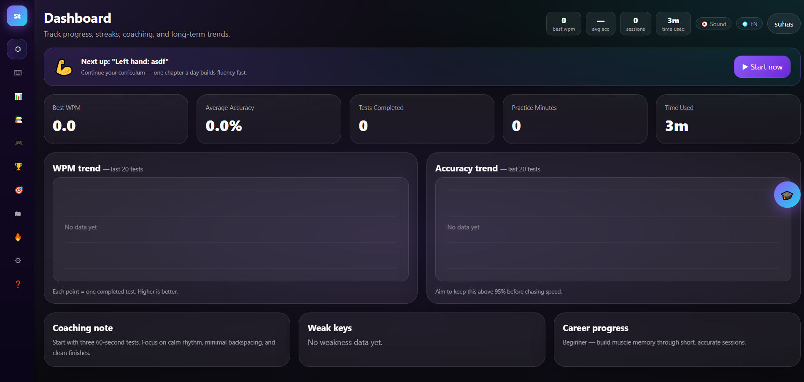

# Santypes ⌨️

A clean, modern web-based typing speed and accuracy test application built to help users practice and improve their typing skills.

🌐 **Live Website:** [san-types.web.app](https://san-types.web.app/)

## Preview 📸




## ✨ Features

- **Real-time WPM & Accuracy Tracking:** Instant statistics on speed (Words Per Minute) and typing precision.
- **Minimalist & Distraction-Free UI:** Clean visual design tailored for focus and smooth user experience.
- **Responsive Design:** Optimized for seamless performance across desktop and tablet browsers.

---

## 🛠️ Built With

- **HTML5**
- **CSS3**
- **JavaScript**
- **Firebase Hosting**

---

## 🚀 Getting Started

To run this project locally:

1. **Clone the repository:**
   ```bash
   git clone [https://github.com/suhas-hoskere/santypes-.git](https://github.com/suhas-hoskere/santypes-.git)
